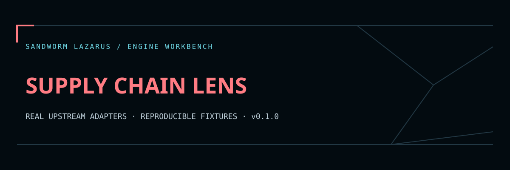

# Sandworm Supply Chain Lens



Normalize SBOMs, review package/version changes, and compare Grype vulnerability evidence. Built by Sandworm-Lazarus on the documented Syft/Grype interfaces; the engines remain Anchore projects. Original code is MIT. Both upstream engines are Apache-2.0.

เครื่องมือดูส่วนประกอบซอฟต์แวร์และเปรียบเทียบก่อน–หลังอัปเดตของเรา รองรับ Syft JSON, CycloneDX และ SPDX พร้อมผล Grype แยกชัดเจนระหว่าง “ยังไม่สแกน” กับ “สแกนแล้วไม่พบรายการ” กรณีระบุตัวแพ็กเกจซ้ำกำกวมจะหยุดแทนการเดา

## Quick start — import reports without engines

Python 3.11+ on Linux. Runtime has no Python third-party dependencies.

```sh
python -m sandworm_lens import-report examples/sbom.cdx.json --grype-report examples/grype-report.json --out report.json
python -m sandworm_lens import-report examples/sbom.cdx.json --out sbom-only.json
python -m sandworm_lens diff report.json sbom-only.json --out comparison.json
python scripts/validate.py
```

Open `web/index.html` for the Sandworm-themed report viewer; load the synthetic example or import a generated report. If local-file restrictions apply, serve it with `python -m http.server 8080 --directory web`. The viewer does not execute scans or upload reports. All example vulnerabilities are invented.

## Actual local Syft and Grype integration

`upstream-lock.json` pins **Syft 1.57.1** and **Grype 0.121.3**, with official Linux/amd64 release asset SHA-256 checks. No binaries or vulnerability DBs are committed.

```sh
python scripts/install_upstream.py
mkdir -p .runtime/grype-db
# Explicitly fetch the upstream Grype vulnerability database, without scanning a project:
GRYPE_DB_CACHE_DIR="$PWD/.runtime/grype-db" .tools/grype db update
# Generate SBOM and scan against that local DB; updates are disabled during scanning:
python -m sandworm_lens scan ./YOUR_PROJECT --syft "$PWD/.tools/syft" --grype "$PWD/.tools/grype" --db-cache .runtime/grype-db --out report.json
```

Omit `--db-cache` to run only Syft: the report explicitly says `vulnerability_scan: not-run`; it never claims a completed clean scan. Syft receives a `dir:` local source, not a registry URL or Docker socket. The adapter supplies an empty config file to avoid ambient config discovery, a minimal credential-free environment, and disables update checks. Grype auto-update is disabled. Missing/stale/unusable offline DBs fail according to the engine's validation.

## Identity, ambiguity and diffs

Schema **2** separates the versionless package family from each versioned upstream package occurrence. Family identity retains the previous PURL normalization: remove only the version, sort/decode qualifier values, and keep the base/subpath exact; without PURL use type+name. An explicit package version must agree with a version-bearing PURL; an omitted version can be read from that PURL.

Occurrence identity hashes the family, exact version, source format and hashed native reference: Syft artifact `id`, CycloneDX `bom-ref`, or SPDX `SPDXID`. Distinct references preserve repeated copies of the same version. Native references identify upstream package records, which may aggregate several physical locations; this is not an inventory of each installed file. Source references are exported only as SHA-256 digests, never original paths or reference strings.

A missing native reference uses an explicit version-level record (`source.ref_sha256: null`). Only identical records collapse at that level; the number of installed copies is unknown. Reference-free records carrying location evidence (Syft locations, CDX occurrences/properties, SPDX packageFileName/hasFiles) are rejected rather than silently discard their occurrence information. Reused native references with conflicting normalized metadata are rejected, including across versions.

Grype mapping first requires the same family and exact version. A native Syft artifact ID, when supplied for referenced Syft candidates, must match the same source-reference hash. CycloneDX bom-ref and SPDXID are **not** assumed to equal Grype's generated artifact ID. Without a usable native Syft ID, exactly one family/version candidate is required. Repeated-version ambiguity fails; findings are never copied to every candidate. Conflicting duplicate findings fail.

Package diffs contain exact occurrences added and removed. They do not invent version-upgrade pairs, match locations across different source formats, or pair changed native references. Vulnerability new/resolved evidence is compared only when both reports have completed Grype results; incomplete comparisons leave both lists empty. A removed finding is not proof of remediation.

### Migrate schema 1

The viewer continues to display schema-1 reports. Engine comparison requires schema 2 for both inputs: run `import-report` again using the original SBOM and optional Grype files, then compare the regenerated reports. Legacy reports lost occurrence references, so automatic migration would fabricate identity. The historical `examples/report.json` remains a schema-1 compatibility fixture; `examples/multiversion/` contains synthetic schema-2 cases. Source-format changes conservatively appear as removed/added occurrences.

รายงานอาจมีชื่อแพ็กเกจและรุ่นภายในองค์กร จึงควรตรวจทานก่อนแชร์ SHA-256 ยืนยันว่าใช้ข้อมูลชุดเดิม ไม่ใช่ใบรับรองความปลอดภัย และรายการที่หายอาจเกิดจากฐานข้อมูลหรือขอบเขตการสแกนเปลี่ยน

## Validation and operations

`python scripts/validate.py` writes the exact source/fixture hash manifest in `reports/validation.json`. `python scripts/smoke.py --db-cache .runtime/grype-db` runs the pinned real Syft and Grype against the synthetic local project. No registry is queried with project contents. `reports/live-smoke.json` records observed results and DB provenance; the fixture has no expected real vulnerability.

Deploy the CLI in a disposable Linux worker/container with read-only source and bounded resources. This repository does not provision an always-on worker or hosted service. Use your own scheduler/CI. See [SECURITY.md](SECURITY.md), [development notes](docs/DEVELOPMENT.md), and [upstream notices](THIRD_PARTY_NOTICES.md).

Outputs must use a new file name. Creation is atomic and exclusive: existing reports, scanned files and symlinks are never overwritten. JSON file inputs must be regular files; FIFOs, devices and symlinks are rejected before reading.

## Sandworm report workspace

The original Sandworm navy/coral theme is included in `web/`. Read [the viewer guide](docs/WEB_VIEWER.md) for local serving, normalized JSON import and export, and [verification scope](docs/BROWSER_QA.md) for the browser QA limit. Run `node --test tests/web.test.cjs` alongside the engine checks above. No worker or scheduler is deployed by opening this static viewer.

The cloud development and upstream smoke checks are reproducible from this repository. A continuously running service needs your own worker/server, authentication, job limits and operational setup. Public source contains synthetic fixtures; local dependencies, secrets, scan targets, model caches and databases are excluded.

Original Sandworm code is MIT-licensed. Upstream engines retain their respective licenses and credit; embedded fonts use OFL with notices in `web/fonts/`.

## Multi-version development validation — 2026-11-13

Synthetic fixtures cover Syft/CycloneDX/SPDX with three native references and two versions, repeated-version Grype mapping/refusal, reference conflicts, PURL version consistency, legacy migration, incomplete scans and schema-2 viewer cards. `python scripts/validate.py` and `node --test tests/web.test.cjs` are configured for branch pushes and pull requests. Hosted checks for this change are pending execution; committed historical validation/smoke files describe earlier source. The authored viewer fixture is not evidence of a new real-engine scan.
